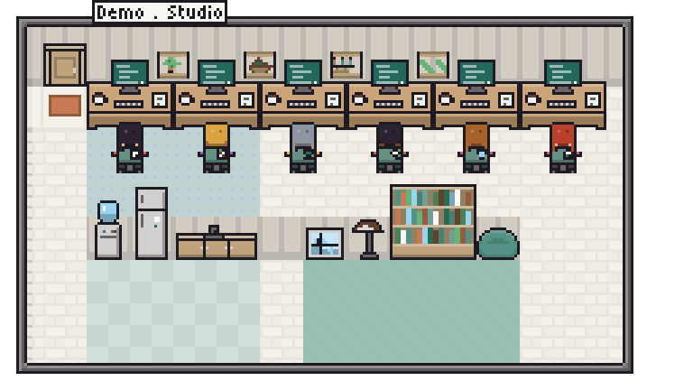

# Agent Lobby 2.0

A plugin that shows your agents as a small pixel-art office. Each workspace is a room, each
agent has a desk, and a character's pose tells you what its agent is doing: typing, waiting for
you, finished, resting, or gone home. It lives in a side pane and is meant to be glanced at.

<p>
  
</p>

The previews use Demo Mode fixtures. [Daylight](docs/lobby-v2-day.png) · [Night](docs/lobby-v2-night.png) · [Chat at phone width](docs/lobby-v2-phone.png).

It adds two things to Paseo:

- **Lobby tab** in a workspace's Explorer (also openable as a workspace tab): the room of that
  workspace, with a switch to show every workspace. A header button and the Command Center item
  **Open Lobby** open it.
- **Lobby surface** (Command Center: **Open Lobby across workspaces**): every workspace at once as
  one floor plan, rooms of different sizes sharing walls, each with its own door. Workspaces whose
  agents are all closed stay folded away until a search or the Closed filter asks for them.

## Reading the office

| State | What you see |
| --- | --- |
| Working | seated and typing, code scrolling on the screen |
| Needs you | at the desk with a `?`, and the permission request in a bubble |
| Failed | at the desk, error screen, a cross |
| Ready | at the pantry with the others who have finished, a check bobbing over its head, its screen left on; after 15 minutes, standing at its desk |
| Idle | resting for 15 minutes (on the sofa, dozing, reading, at the shelves, stretching), then asleep at the desk |
| Closed | no desk: it walks out, and the room's filing cabinet counts it |

<p>
  
  
</p>

<p>
  
</p>

<p>
  
</p>

Dark versions: [surface](docs/lobby-surface-dark.png), [list](docs/lobby-list-dark.png),
[close-up](docs/lobby-closeup-dark.png).

- **Messages.** A message from one agent to another shows as a pixel bubble over the sender and an
  envelope that travels to the recipient's desk. A working agent's bubble names its tool in a word
  (`Bash`, `Read`, `Edit`, `Web`, ...) or shows the start of what it is saying, on up to three
  short lines. A screen reader gets the full line.
- **Walking.** When an agent starts work, finishes, takes a break or closes, its character walks
  there along the aisle and the room's corridor. A new agent walks in from the door.
- **Room character.** Each workspace gets a stable, seeded interior look: its own muted color tint,
  floor pattern, furniture arrangement and small wall pieces. The room keeps its look as agents
  start, finish or move between states.
- **Seats.** A seat comes from who started an agent and when, never from what it is doing, so
  nobody moves when somebody else starts or finishes. Closing is the one thing that frees a desk:
  the agent walks out, then the teammates seated after it walk one desk up.
- **Teams.** Agents started by the same agent sit together on a floor of their own. An agent whose
  starter lives in another workspace's room has that starter standing in its lounge as a visitor.
- **Closed agents.** Pressing a room's filing cabinet lists them, each with what can still be done.
- **Search and filters.** They dim everyone who does not match, in place, and mark the cabinet of a
  room with a closed agent that matches.
- **Detail.** On a phone, tapping a character opens a bottom sheet with larger controls for
  Message, Open chat, avatar and agent information. The recent transcript uses the host UI font
  and groups tool calls in expandable rows. Questions retain their choices and free-text fields.
  Tool permissions open a review with explicit actions. On desktop, the draggable dock keeps the
  chat next to the map and follows the latest message while you are at the end.
- **Agent list.** The toggle beside Office opens the same agents in a list with their written
  status and recent chat.
- **Roles.** The optional `ghostline/role` label supports Planner, Developer, Reviewer, Security,
  Tester, Researcher, Overseer, Nexus and Meow. A generic avatar is available for other labels.
- **Motion.** Office settings offer System, On and Off. System follows the device’s Reduced Motion
  preference. Off keeps the relevant pose while stopping walks and animation loops.

## Supervision

Open **Supervision tools** in the Lobby toolbar. Availability follows the selected room or All rooms.

On phones, **Find an agent** can search the current room or all rooms; choosing a match centers the
map and opens that agent. Inbox and Results start with the selected room, with an explicit All rooms
option. Results are split into **To see** and **Seen**; the bulk action marks only the results in
the current list. The sheets show refresh state and last update, and warn when Paseo's directory
has reached its 2,000-agent loading limit. Agent details put the next useful action first, keep
message drafts per agent, and label activity timestamps as live, observed, or simply an agent update
when detailed timeline data is unavailable. In chat, **Jump to latest** returns to the newest reply.

- **Agent activity** shows observed tool activity, timestamps and available resources. Rows identify
  an acknowledged live timeline or a saved snapshot. Click the agent to open the full conversation.
- **Task board** is also available by tapping a room nameplate. It uses structured Paseo `todo`
  snapshots with agent and workspace attribution. Use **Load recent tasks from an agent** to read
  that agent’s recent history. Completion counts cover the latest available boards.
- **Notifications** list pending response requests, observed errors and completions, and explicit
  connection loss and recovery. Choose All, Action needed or Off. Inbox remains available in each mode.
- **Session replay** uses a bounded in-memory journal of 1,200 observations per connection. Play,
  pause, seek by seconds or event, and select 1×, 2× or 4×. An on-demand read can add up to 120 recent
  projected timeline entries for one agent. Replay operates on the local scene and is read-only.
- **Office metrics** show directory counts, pending responses, observed completed tasks and timing
  where the required timestamps are present. Mean observed session span measures from creation to an
  observed state change to Closed. A missing observation is displayed as Unavailable.

Roles and animations use structured reading, editing, search, shell, test and planning events.
A successful test effect requires an explicit successful tool outcome with exit code zero.
At most two effects appear at a time. Conversation in the lounge is ambient, with no messages
sent to agents. The live inbox and speech bubbles show actual communications.

## Personalize

- In an agent’s detail sheet, tap the palette icon to customize hair, skin tone, clothing,
  accessories and headgear. Changes save for that agent on the host. Randomize picks an
  appearance, and Reset returns to the deterministic look from its ID.
- Open **Office settings** to adjust a room’s floor, walls, palette, decor, furniture and break
  frequency. Settings include a preview, Regenerate, Reset, and JSON preset import/export.
  Furnishings appear in the space available at the current width. The office places desks and
  keeps the door and corridors clear. Existing presets gain defaults for new fields.
- Day, Night and Auto change the office lighting. Auto uses local time with daylight from
  07:00 to 19:00. Office settings also control simulated breaks, result effects and the optional cat.
  The cat uses local paths and poses and stays asleep with Reduced Motion enabled.

## Demo and privacy

Use **Open Lobby demo** in Command Center or **Play demo** in Office settings. Two reproducible
scenarios show six roles, a subagent, parallel work, messages, questions, recovery and closure.
Playback, restart and answers are local to the demo. The demo continues to run after disconnecting
once the app has loaded the plugin bundle.

In **Privacy and export**, enable Privacy Mode before sharing. It gives agents and rooms stable
aliases for the view session, hides chat and resource details in Lobby, and routes access to the
full conversation and permission review through an explicit **Open in Paseo** action. On Web,
**Export office PNG** renders the current scene with the selected privacy setting. It includes
rooms, avatars and state icons. On iOS and Android, open the office with Privacy Mode enabled and
use the device’s screenshot controls to capture the scene.

## Size

The office is small on purpose. It is drawn at the crisp size nearest 1.2 screen pixels per art
pixel and never under 1: 1.2 on a 1.67x display, 1.0 on 1x and 2x displays, 1.33 on 3x. A
character is about 19 by 29 pixels on a 1.67x display, and a four-desk room with its pantry and
lounge fits a 313-pixel Explorer pane as a strip about 115 pixels tall. Bubbles and the cabinet's
count are drawn at the same scale, in a 3 by 5 pixel face.

A pane 720 pixels wide or more, such as the Lobby as a workspace tab or the Lobby surface, draws
the office larger in step with its width: 1.2 times the width over 720, at the crisp size at or
below that, up to 2. On a 2x display a 900-pixel pane draws it at 1.5 and a 1200-pixel one at 2.
The size depends on the pane alone, so the office keeps it as rooms come and go.

The magnifier buttons beside the search draw it smaller or larger by hand, one device pixel per art
pixel at a time, up to 3 and no larger than a room still fits across; Auto goes back to the size
above. The size picked is kept on the device, one for the Explorer tab and one for the surface:
across visits on the web, until the app closes on a phone.

## Performance

Lobby recalculates room geometry when seats, rooms or furnishings change. The scene draws
agents and furniture within the vertical viewport and keeps a small margin around it. Live details
still share the same cap of eight timeline subscriptions per connection.

The 10-, 30- and 100-agent model benchmark and its comparison with the original release are
recorded in the [implementation plan](IMPLEMENTATION_PLAN.md).

## Data

One page-walk of `agents.list` when the pane is shown and one list subscription, whose
`agent_update` events are applied in place. The subscription replays nothing after the connection
drops, so when it is restored agents and workspaces are both loaded again; the same on Refresh and
whenever the pane is shown again. As a last resort agents are refetched every five minutes: that
is the longest a lost update can go unrepaired while the connection itself looks healthy.
Workspace names come from `workspaces.list` and refresh on `workspace_update`, and when an agent
turns up in a workspace not yet known. Those `workspace_update` events only reach a plugin through a
list subscription of its own, so the plugin keeps one open for as long as it is loaded, shared by
the header buttons and every view.

Speech and messages come from agent timelines. Each timeline subscription costs the daemon one, so
the plugin keeps at most eight open per daemon connection, however many Lobby tabs and surfaces
are mounted: views share one registry, and two views watching the same agent share one
subscription. Each view asks for the working and waiting agents of the rooms it has on screen;
when the eight are taken, a view goes without and asks again half a minute later. Everyone else is
drawn from `agent_update` alone. The chat of the selected agent draws on the same eight: it shares
a subscription the bubbles already hold, takes one only while the agent is working or waiting on
you, and gives it back when you look elsewhere, when the agent stops or when the pane is hidden. An
idle agent's chat is one request for its last 60 timeline entries, about 40 to 120 KB for a busy
agent, most of it tool output. A message typed by a person is never read as a message between
agents: only the daemon's own record of an agent-to-agent message, with its verified sender, is.

## Art

Every sprite, tile and the two pixel fonts are original and drawn in `client/pixel/` as code: text
grids, a palette taken from the Paseo theme, and a small PNG encoder. No third-party asset is
bundled.

## Install

Run this from the Agent Lobby 2.0 checkout.

```bash
paseo plugin install "$PWD"
```

Requires Paseo 0.16.1 or newer. Enable plugins on the daemon before installing. Paseo compiles
the client and server contributions on install and reload. Node 24 is required for local development.

## Develop

Use Node.js 24 or newer and install development dependencies before checking changes:

```bash
npm ci
npm run check                # tsc + vitest
paseo plugin reload lobby    # recompile and reload in the running app
```

- `client/model.ts`: agent state, the forest of who started whom, filters. Pure, tested.
- `client/office-model.ts`: rooms, desks, seats, zones, breaks, where each character is. Pure, tested.
- `client/exchanges.ts`, `client/feed-plan.ts`, `client/feed-hub.ts`: messages and bubbles, which
  timelines to subscribe to, and the shared budget. Pure, tested.
- `client/chat-model.ts`: the selected agent's chat, folded from a page and its live events, and
  when it subscribes. Pure, tested. `client/use-chat.ts` and `client/chat.tsx` bind and draw it.
- `client/scene-model.ts`, `client/motion-model.ts`, `client/wake.ts`: scale, walk paths, frame
  timing, when a hidden pane lets go. Pure, tested.
- `client/pixel/`: the art, the fonts and the encoder. Pure, tested.
- `client/office.tsx` is the scene and draws only through `client/sprites.tsx`;
  `client/crew-view.tsx` hosts the office, the list, the detail and the dialogs;
  `client/web.ts` is the only file that touches a browser node.

## Known limits

- Paseo’s documented task updates provide pending, in-progress and completed states.
  Lobby can display an explicitly structured blocked state if a provider supplies it.
  Free-form text is shown as conversation.
- The timeline can omit older turns, creation details and historical state changes. Replay displays
  the observations it has. The current journal is kept in memory for the connection.
- Test results need a recognized test command and an explicit exit code. The SDK has no shared
  marker for a finished report. Metrics omit cost, token and context totals.
- On-device iOS and Android validation requires a physical device or simulator. The implementation
  plan records the exact visual and performance checks performed.
- At most four characters walk out at once. At larger simultaneous departures the scene updates
  the remaining characters together.
- The pixel font supports Italian, Romanian and common Latin accents. Longer text is readable in
  a standard UI font in the details panel.

See [implementation and benchmark results](IMPLEMENTATION_PLAN.md).

## Acknowledgements

- [agent-town](https://github.com/geezerrrr/agent-town) for the idea of agents as workers in a
  pixel office, with seats, wandering and speech bubbles as the language of state. None of its
  code, art, tiles or map is used here.
- [Gather](https://www.gather.town) for the picture of a shared office seen from above.
- [Bàn về multi-agent orchestration và mô hình SLP](https://vhlam.com/article/agent-orchestration-multi-agent-slp),
  the article that inspired this project: it is what made orchestrating agents a daily practice,
  and it opened up what working with agents can be. With gratitude to its author.
- [Paseo](https://paseo.sh) ([source](https://github.com/getpaseo/paseo)) and its plugin SDK, which
  this runs on and whose plugin documentation it follows.
- [React Native](https://reactnative.dev) and
  [React Native for Web](https://necolas.github.io/react-native-web/), the primitives everything
  here is drawn with.

Licensed under MIT, as declared in `package.json`.
