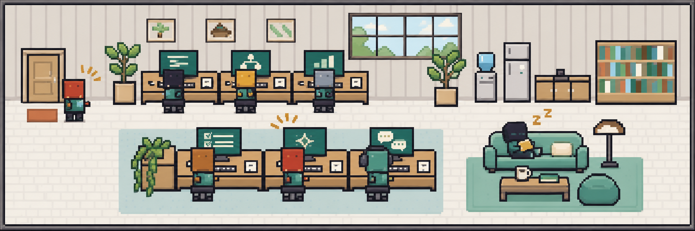

# Agent Lobby

Agent Lobby è un plugin per [Paseo](https://paseo.sh) che rappresenta gli agenti come personaggi in un piccolo ufficio pixel art. Lo stato di un agente si vede dalla posa e dalla postazione: chi lavora scrive alla scrivania, chi aspetta una risposta mostra una richiesta, chi ha finito si sposta nell’area comune.

Il plugin è pensato per essere consultato a colpo d’occhio nel pannello laterale, ma include anche chat, strumenti di supervisione e impostazioni per personalizzare stanze e personaggi.

<p>
  
</p>

Anteprime dell’interfaccia: [giorno](docs/lobby-v2-day.png) · [notte](docs/lobby-v2-night.png) · [vista mobile](docs/lobby-v2-phone.png) · [tema scuro](docs/lobby-surface-dark.png).

## Cosa include

- **Lobby del workspace** — una stanza con gli agenti del workspace selezionato; può essere aperta dall’Explorer o come scheda.
- **Lobby globale** — una pianta unica con le stanze di tutti i workspace. Le stanze senza agenti attivi si possono mostrare con la ricerca o il filtro degli agenti chiusi.
- **Vista a elenco e dettagli** — stato testuale, attività recente e chat dell’agente selezionato. Su schermi piccoli i dettagli si aprono in un pannello dal basso.
- **Supervisione** — richieste in attesa, risultati, attività, bacheca dei task, notifiche, replay della sessione e metriche osservate.
- **Personalizzazione** — aspetto dei personaggi, arredi e palette delle stanze, illuminazione, animazioni, notifiche, effetti e gatto opzionale.
- **Privacy ed esportazione** — Privacy Mode sostituisce nomi e dettagli della conversazione nella Lobby. Sul Web è possibile esportare la scena come PNG.
- **Demo locale** — scenari riproducibili per esplorare l’interfaccia senza un feed di agenti attivo.

### Stati degli agenti

| Stato | Rappresentazione |
| --- | --- |
| In attività | Alla scrivania, con monitor animato e indicazione dello strumento in uso |
| In attesa | Alla scrivania con un punto interrogativo e la richiesta da esaminare |
| Errore | Monitor con errore e indicatore di avviso |
| Pronto | Nell’area comune con un segno di spunta |
| In pausa | Nell’area relax; dopo un periodo di inattività dorme alla scrivania |
| Chiuso | Esce dalla stanza; l’archivio permette di aprire l’elenco degli agenti chiusi |

I personaggi camminano tra scrivanie e aree comuni. I posti dipendono dall’ordine di avvio degli agenti, così i cambi di stato non spostano la squadra.

## Installazione

Requisiti: Paseo **0.16.1 o successivo** e plugin abilitati sul daemon Paseo. Dalla directory del progetto esegui:

```bash
paseo plugin install "$PWD"
```

Una volta caricato, apri **Open Lobby** dal Command Center per il workspace corrente, oppure **Open Lobby across workspaces** per la vista globale. **Open Lobby demo** apre gli scenari dimostrativi. In un workspace è disponibile anche la scheda **Lobby** nell’Explorer.

## Sviluppo

Per lo sviluppo locale serve Node.js **24 o successivo**.

```bash
npm ci
npm run check
paseo plugin reload lobby
```

`npm run check` esegue il controllo TypeScript e la suite Vitest. Il comando di reload ricompila e ricarica il plugin nel Paseo in esecuzione.

Per rigenerare le anteprime pixel giorno/notte dai dati della demo:

```bash
node_modules/.bin/vite-node scripts/render-previews.ts
```

## Struttura del progetto

| Percorso | Responsabilità |
| --- | --- |
| `index.client.tsx` | Registra pannello workspace, schermate, pulsanti e comandi del Command Center |
| `index.server.ts` e `server/` | Registra le preferenze e gli handler server per richieste e risultati |
| `client/crew-view.tsx` | Compone Lobby, elenco, dettagli, dialoghi e pannelli di supervisione |
| `client/model.ts`, `client/office-model.ts` | Modelli degli agenti, dei team, delle stanze, dei posti e delle pose |
| `client/use-feed.ts`, `client/feed-hub.ts`, `client/exchanges.ts` | Sottoscrizioni alle timeline e proiezione di attività, chat e messaggi tra agenti |
| `client/pixel/` | Sprite, font, palette, animazioni e codifica PNG, disegnati via codice |
| `shared/` | Schemi delle preferenze e tipi condivisi tra client e server |
| `tests/` | Test dei modelli, dei controller, dei feed e della grafica pixel |

Il renderer pixel è descritto in [client/pixel/README.md](client/pixel/README.md). Il documento [IMPLEMENTATION_PLAN.md](IMPLEMENTATION_PLAN.md) raccoglie decisioni tecniche, limiti delle API e benchmark.

## Dati e limiti

Agent Lobby legge la directory di agenti e workspace e usa le timeline Paseo per mostrare attività e conversazioni. Le sottoscrizioni alle timeline sono condivise tra le viste e limitate a **otto per connessione**; gli altri agenti restano visibili tramite i dati della directory. Il replay conserva fino a **1.200 osservazioni in memoria** per connessione e non modifica la sessione.

Le impostazioni di stanze, notifiche, privacy e avatar vengono salvate come preferenze host di Paseo. Il server del plugin osserva completamenti e richieste di permesso per alimentare risultati e inbox. Invio di messaggi, risposta ai permessi e archiviazione avvengono quando l’utente sceglie l’azione corrispondente.

La cronologia disponibile dipende dai dati forniti da Paseo e dal provider: il replay può non includere eventi storici, chiusure o turni precedenti. La bacheca usa gli aggiornamenti `todo` strutturati; il testo libero resta conversazione. La validazione nativa su iOS e Android richiede un dispositivo o simulatore.

Con Privacy Mode attiva, Lobby usa alias stabili per la sessione e nasconde dettagli di chat e attività nella propria interfaccia. Prima di condividere una cattura, abilita la modalità dalle impostazioni **Privacy and export**. L’esportazione PNG è disponibile sul Web; su iOS e Android si usano i controlli di cattura del dispositivo.

## Arte e licenza

Sprite, arredi, font pixel e icone sono disegnati nel codice del progetto; non sono inclusi asset grafici di terze parti. La licenza dichiarata in `package.json` è MIT.

L’idea di rappresentare gli agenti come una squadra in un ufficio pixel art è stata ispirata da [agent-town](https://github.com/geezerrrr/agent-town). Il progetto non ne contiene codice né grafica. Agent Lobby usa il plugin SDK di [Paseo](https://github.com/getpaseo/paseo), React Native e React Native for Web.
